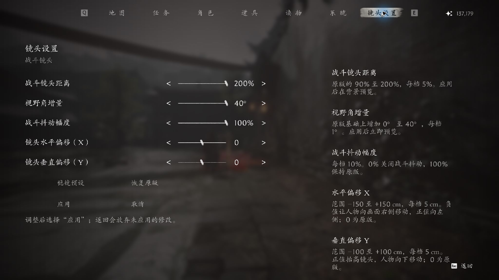

# 影之刃零 · 稳镜设置

**PBZ Steady Camera · v0.1.3-beta**

在游戏原生 **Esc → 镜头设置** 页面中调整战斗镜头距离、视野角增量、抖动幅度以及镜头坐标偏移。提供稳镜预设、应用、取消与恢复原版。

[下载测试版](https://github.com/zhanghaoqi1/PBZ-Steady-Camera/releases/latest) · [中文安装说明](docs/README_简体中文.md) · [English](docs/README_EN.md) · [源码构建](README_BUILD.md)



截图来自同源镜头实现的游戏内验证。

| 设置 | 范围 | 每档 | 首次默认 |
|---|---|---|---|
| 战斗镜头距离 | 原版的 90%–200% | 5% | 110% |
| 视野角增量 | 原版基础上 +0° 至 +40° | 1° | +0° |
| 战斗抖动幅度 | 0%–100% | 10% | 60% |
| 镜头水平偏移（X） | -300 至 +300 cm | 5 cm | 0 |
| 镜头垂直偏移（Y） | -300 至 +300 cm | 5 cm | 0 |

点「应用」后保存并立即刷新设置页背景中的镜头，返回游戏生效。「取消」、切换页签或 Esc 返回会放弃草稿。「恢复原版」对应距离 100%、FOV 增量 0°、抖动 100%、XY 偏移归零，仍需点「应用」。

0.1.3 修复了「恢复原版」后点应用画面不回退的缺陷：距离与 XY 偏移是原生 additive override，暂停时相机组件不 tick，移除 override 不会重算暂停中的画面，此前必须再动一次滑条才生效。现在回退时先写入零值让背景立即回到原版，override 条目在解除暂停后移除。

坐标偏移以厘米为单位，每档 5 cm：负的 X 让人物向右移动（镜头相对左移），正的 Y 抬高镜头、人物在画面中下移；0 为原版。偏移量接近 ±300 cm 时，镜头可能穿过门框、墙壁或天花板，与原版镜头一样不做碰撞修正。

## 安装

1. 完全退出游戏，下载 Release 中的 `PBZ_SteadyCamera_v0.1.3-beta.zip`。
2. 移除旧组合版的三个 `zz_PBZCombat_P` 文件（如果装过）。
3. 将 ZIP 中的 `ProjectPBZ` 文件夹复制进游戏根目录。三个文件应位于：

```text
PBZ/ProjectPBZ/Content/Paks/~mods/
  zz_PBZCamera_P.pak
  zz_PBZCamera_P.utoc
  zz_PBZCamera_P.ucas
```

三个文件必须一起保留。正常通过 Steam 启动，在 Esc 菜单最右侧打开「镜头设置」。卸载时关闭游戏，仅删除上述三个文件。独立配置位于 `%LOCALAPPDATA%/ProjectPBZ/Saved/PBZCamera.json`。

## 兼容与验证范围

- Windows x64 / Steam Build **26266538**，**CL-301524_JKS-17219**，UE **5.7.4**。
- 本项目仅包含镜头功能，不含 Boss 再战或伤害、技能、AI 修改。运行时使用游戏内置 Puerts。
- 42 项 Node 行为测试、4 项 Python 发行测试、PAK 解包哈希回读及 ZIP 校验已通过。同源镜头逻辑与原生菜单此前已实机验证；0.1.2 的距离/视野角范围与 XY 坐标偏移、0.1.3 的「恢复原版」回退修复均已用同源代码的组合开发版在游戏内实测通过。
- **拆分后的独立发行包尚未重新完成安装到游戏启动的全流程实机走查。** 其他 Build、所有场景、手柄完整导航与超宽屏尚未全面验收。
- 替换 `UI/Widget/SystemBase.js` 和 `Gameplay/GameModeBuild.js`；替换相同脚本或运行时相机的其他 Mod 可能冲突。请勿与旧组合版同时安装。

## 源码与重建

`src/PBZCamera` 为六个自有模块，`tests` 为行为及发行测试。构建所需的两个原版脚本、密钥与外部工具二进制不在此仓库中。请自行从支持版本本地提取原版脚本，并按 [README_BUILD.md](README_BUILD.md) 提供工具路径。构建器校验原版 SHA-256，不修改已安装游戏。

```powershell
node --test tests/camera.test.cjs tests/camera-runtime.test.cjs tests/pause-menu.test.cjs tests/vignette.test.cjs
python -m unittest discover -s tests -p test_release.py -v
```

## 反馈

请在 Issues 提供游戏 Build/CL、其他 Mod 列表、复现步骤及截图。上传日志前请自行移除个人信息。本 Mod 没有联网、更新器或遥测功能。

非官方 Mod，与游戏开发商、发行商无隶属关系。游戏名称、画面及原始资源归各自权利人所有。仓库未另行添加开源许可。
